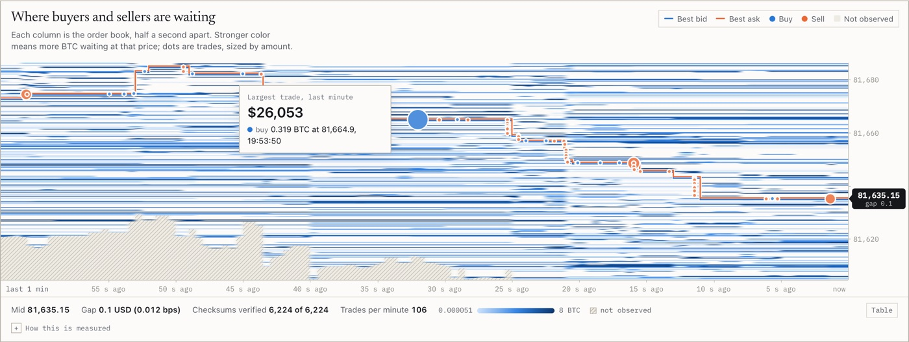

# orderbook-microstructure

A live copy of Kraken's BTC/USD order book, rebuilt in the browser from more than a hundred updates a second and checked against the exchange's own checksum after every one. Only then does it measure how buying and selling pressure moves the price.

**Live:** [tanaypratapsingh.github.io/live/book.html](https://tanaypratapsingh.github.io/live/book.html)

<picture>
  <source media="(prefers-color-scheme: dark)" srcset="docs/screenshot-dark.jpg">
  
</picture>

Every trading system starts from a local copy of the order book, built from a snapshot and a stream of deltas, and the classic failure is silent drift. Miss or misapply one update and every number computed from the book is quietly wrong. Kraken publishes a CRC32 of the top of its book with every update, so drift does not have to be silent: this page verifies every message, resyncs automatically on a mismatch, and computes its statistics from a book that is known to match the exchange.

## What it measures

| Card | Method |
| --- | --- |
| Where buyers and sellers are waiting | Resting size by price every 500 ms, log scaled, with the best bid and ask and every trade |
| Book verified | CRC32 over the top 10 levels per side, formatted with the instrument's own precision; unsubscribe and resubscribe on a mismatch |
| Does buying pressure move the price? | Order flow imbalance (Cont, Kukanov and Stoikov 2014) summed per second, regressed on the change in mid by OLS over the last 300 seconds |
| How much is waiting near the price? | Cumulative depth over all 100 subscribed levels |
| Price swings | Realized volatility from mid returns at 1 s and 10 s sampling, annualized, with the gap compared against its own sampling error |

Microprice, spread, top of book imbalance, trade flow, trade sizes and latency fill out the rest. The technical detail sits behind each card's "How this is measured".

## Measured on real data

Node scripts ran the same `book/book.js` against the live feed at depth 100 on October 8, 2026. The logs are in [`runs/`](runs/).

| Run | Length | Book updates | Checksums verified | Mismatches | Resyncs |
| --- | --- | --- | --- | --- | --- |
| BTC/USD | 330 s | 44,533 | 44,534 of 44,534 | 0 | 0 |
| BTC/USD | 330 s | 46,891 (about 142 a second) | 46,892 of 46,892 | 0 | 0 |
| BTC, ETH and SOL, switching | 95 s | 10,211 | 10,214 of 10,214 | 0 | 0 |

In the second BTC/USD run, the order flow regression over the last 300 seconds gave a slope of 1.10 USD per BTC of net flow (standard error 0.059) with R squared 0.54. Realized volatility came out at 27.0% annualized at 1 s sampling against 31.9% at 10 s. Microstructure noise usually pushes the finer sampling higher, so this went the other way; the 10 s figure rests on only 30 returns, and the page compares the gap with that sampling error instead of always calling it noise. Arrival lag was 89 ms at the median and 143 ms at p95, which includes any offset between this machine's clock and Kraken's.

## Run it

```bash
python3 -m http.server 8000
```

Then open `http://localhost:8000`. ES modules do not load from `file://`.

## Tests

```bash
node --test tests/*.test.mjs
```

16 tests on node 22 or newer, nothing to install. The core one replays a real BTC/USD snapshot and the 600 updates that followed it (captured in `tests/fixtures/`) and checks every checksum. Others show that a one unit size error or the wrong precision breaks the checksum, that skipping truncation lets stale levels pile up, that a corrupted update triggers a resync, that hand built order flow cases match the paper's definition, that the regression recovers a known impact, and that realized volatility matches a random walk of known variance.

## Layout

```
index.html                           the page
book/book.js                         CRC32, the book, verification and the statistics: pure, no DOM
book/app.js                          the socket, reconnects, heatmap, depth and charts
assets/                              shared styles, helpers, charts and the paint scheduler
tests/                               node:test suite
tests/fixtures/kraken-book-btcusd.json   the captured book
runs/                                logs of the live runs quoted above
docs/                                screenshots
```

## Limitations

- One venue and 100 levels: liquidity beyond the subscribed depth is invisible.
- Trade direction is the exchange's taker side, not inferred.
- Latency includes clock offset.
- Browsers throttle timers in hidden tabs, so heatmap columns sampled while the tab is hidden are sparse.
- A natural checksum mismatch never happened in testing; the resync path is exercised by a forced corruption and by the test suite.

## Data

Kraken public WebSocket API v2, under Kraken's terms. This is analytics on public market data, not investment advice.

Part of the [live data dashboards](https://tanaypratapsingh.github.io/live/) on my portfolio. MIT licensed.
